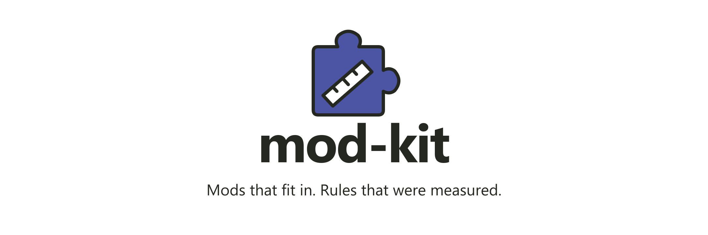

<div align="center">
  <picture>
    <source media="(prefers-color-scheme: dark)" srcset="assets/banner-dark.png" />
    
  </picture>
  <h1>Mod Kit</h1>
  <p><strong>Mods that look like part of Claude Code.</strong></p>
</div>

<p align="center"><strong>Available on</strong></p>
<table align="center">
  <tr>
    <td align="center"><a href="#claude-code"><br />Claude Code, primary host</a></td>
    <td align="center"><br /><del>Codex</del></td>
    <td align="center"><br /><del>Antigravity</del></td>
  </tr>
</table>
<p align="center"><small>Mod Kit has no Codex package and no Antigravity package.</small></p>

<p align="center"><a href="#install"><strong>Get started</strong></a> · <a href="#what-is-this">What is this?</a> · <a href="#how-it-works">How it works</a> · <a href="#what-you-can-do">What you can do</a> · <a href="#the-numbers">Evidence</a></p>

## What is this?

Mod Kit is a plugin for Claude Code, an AI coding assistant. It runs on Claude Code only, because mods are a Claude Code feature. It teaches the assistant how Claude Code draws its own screens, so the mods it builds match them.

A mod is a plugin that draws inside Claude Code: a band above the prompt, a pane beside the chat, a toast, a theme. You ask the assistant for one. The types say what each element accepts, but not how the Claude desktop app draws it. So the buttons touch, a meter looks foreign and the dark theme loses a color.

With Mod Kit the assistant starts from rules measured on the desktop app and the terminal. It picks the element the app itself uses and spaces it in the app's own steps. It paints with theme keys, the named colors that follow light and dark. A second helper reads a finished mod and lists what would break.

<p align="center"></p>

*Ember is the mascot of the Foundry plugins. The scene is an illustration, not a measurement.*

**You ask:** "Make a band that shows the build status, native on the desktop app and in the terminal."

**You get:** a band built from one of the skill's recipes, with every state drawn, and a list of what only a screenshot can prove. This is an illustration, not a recorded session.

## Why you'd want it

- **Native by default.** The assistant reaches for the element and theme key the app uses, not a lookalike.
- **Measured, not guessed.** Each rule says if it was seen, drawn on a test page, read in the build or only stated.
- **The traps, written down.** A list of places where the types promise one look and the app draws another.
- **An audit before you share.** A read-only helper checks one mod and reports each problem with its file and line.

## How it works

Mod Kit adds two things to Claude Code. Neither runs on its own. It has no hooks, the small programs Claude Code runs at set moments. Mod Kit itself sends nothing anywhere.

| Part | What it does |
| --- | --- |
| The skill `mod-native-guide` | A skill is a guide the assistant loads when a task matches it. This one holds the rules, recipes and traps for what a mod draws, on the desktop app and in the terminal. |
| The agent `mod-auditor` | A subagent, which is a helper the assistant starts for one job. It reads a mod's source and never edits it. |

It adds to the `plugin-authoring` skill that ships with Claude Code and does not repeat it. That skill covers how a mod is wired; Mod Kit covers how it looks.

Read [how Mod Kit works](docs/knowledge/how-it-works.md) for the evidence labels, the reference pages and what the audit checks.

## What you can do

| You want to | What to type |
| --- | --- |
| Build a mod that looks native | Describe it, for example "Make a pane that lists open pull requests" |
| Restyle a mod you have | "Make `my-mod` look native in the desktop app and the terminal" |
| Check a mod before you share it | "Audit the mod in `my-mod/`" |
| Find out why a mod draws wrong | "Why do my mod's buttons touch?" |
| Learn what the docs leave out | "What do the mods pages say that `plugin-authoring` does not?" |

### Settings

Mod Kit has no settings.

## Install

### Claude Code

You need Claude Code 2.1.323 or later.

Inside Claude Code, run:

```text
/plugin marketplace add V-Songbird/foundry
/plugin install mod-kit@foundry
```

Then start a new session.

To check that it worked, run `claude plugin list` in a terminal. The list names `mod-kit`.

### Update

In Claude Code, run these. Then start a new session:

```text
/plugin marketplace update foundry
/plugin update mod-kit@foundry
```

## Good to know

| Limit | What it means for you |
| --- | --- |
| The measurements have a build | Each value names the build it was measured on. On a newer build, treat it as likely, not certain. [The evidence labels](docs/knowledge/how-it-works.md#evidence-labels) name the builds. |
| A look is proven only on screen | Tests and source checks never prove a look. Check the desktop app in light and dark, and the terminal, with screenshots. |
| Some rules are not yet seen | A rule labelled `UNVERIFIED` rests on types or inference. Do not ship a look that rests on one without a screenshot. |
| The audit reads source only | `mod-auditor` cannot judge how a mod looks. It lists what only screenshots can prove. |

## The numbers

Each figure comes from recorded test sessions. The figures describe those runs, not yours, and results vary between runs.

The pixel and color values inside the skill describe the app's own screens. They are not results of Mod Kit.

### Claude Code results

<!-- foundry:evidence {"platform":"Claude","status":"pending","reason":"No session measurement of Mod Kit exists."} -->
| Model | Setup | Mods that looked native |
| --- | --- | --- |
| Not measured | Not measured | Not measured |

No Claude Code session has been measured yet. [Mod Kit benchmarks](docs/knowledge/benchmarks.md) keeps the skill's own measurements apart from results of Mod Kit.

## Going deeper

[How Mod Kit works](docs/knowledge/how-it-works.md) · [Mod Kit benchmarks](docs/knowledge/benchmarks.md)

Release notes are on the [Mod Kit releases page](https://github.com/V-Songbird/mod-kit/releases). [Foundry](https://github.com/V-Songbird/foundry) lists the whole family.

Report a bug or ask a question on [Mod Kit's issue tracker](https://github.com/V-Songbird/mod-kit/issues). Report a vulnerability as [SECURITY.md](SECURITY.md) says. To change Mod Kit, read [CONTRIBUTING.md](CONTRIBUTING.md).

## License

MIT, see [LICENSE](LICENSE).
